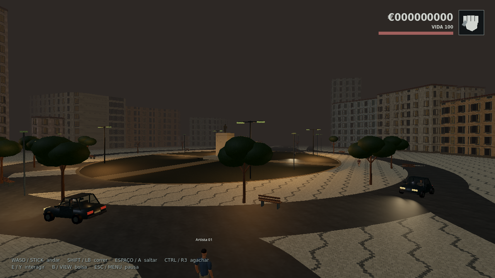
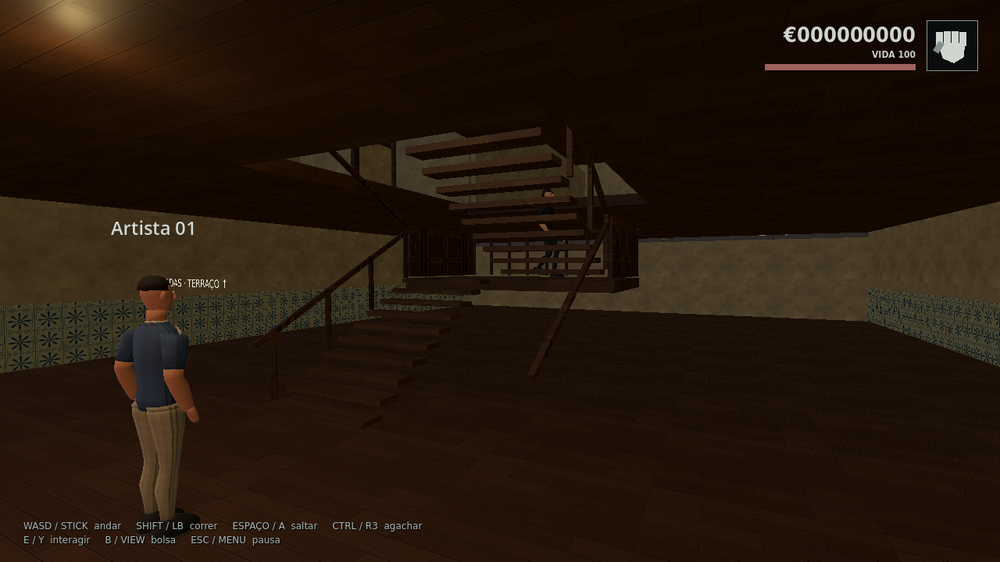
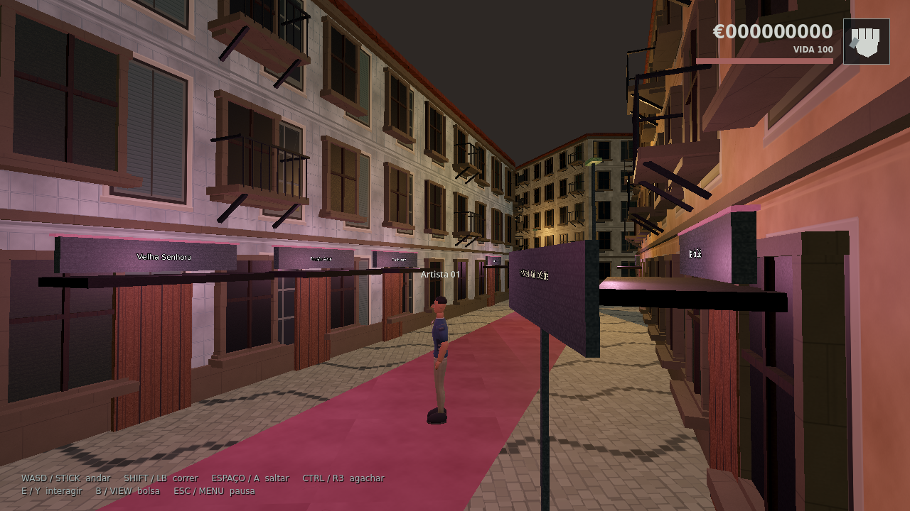
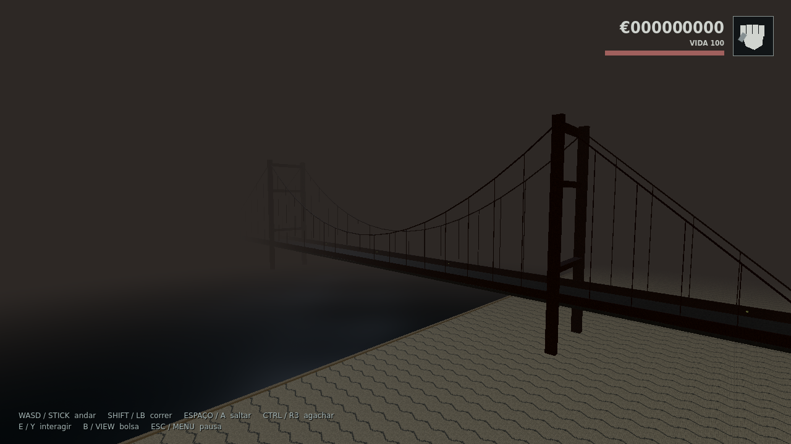
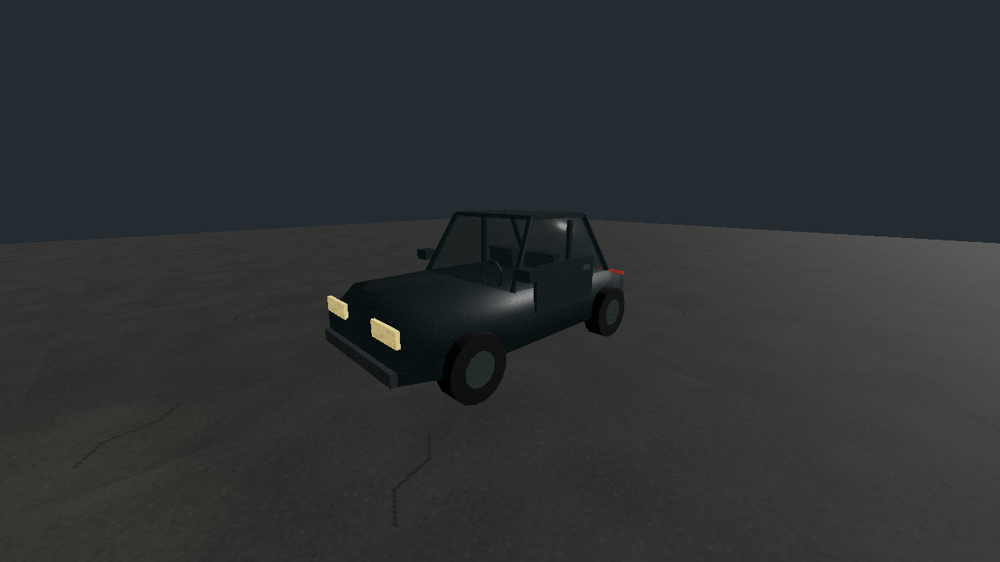
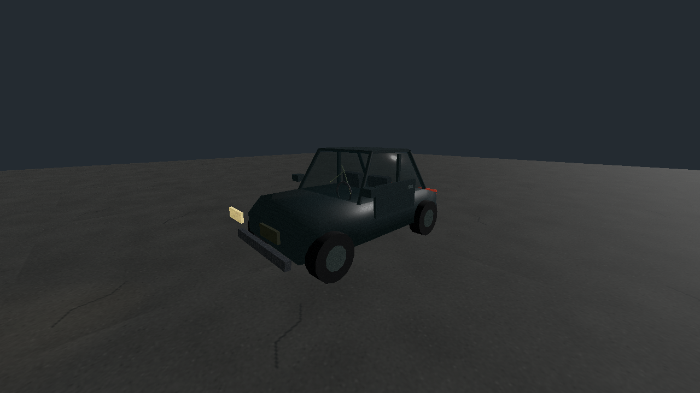
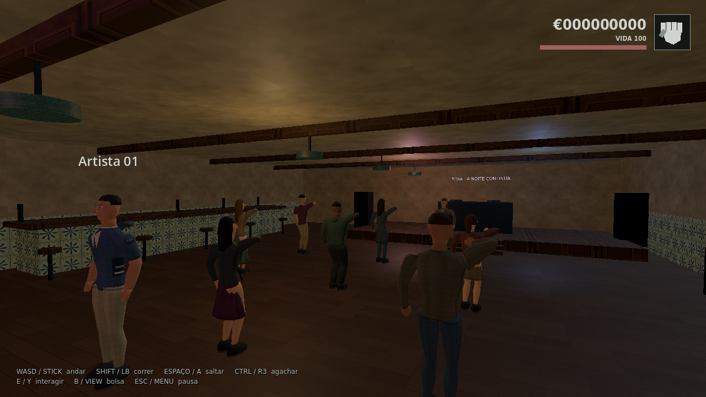
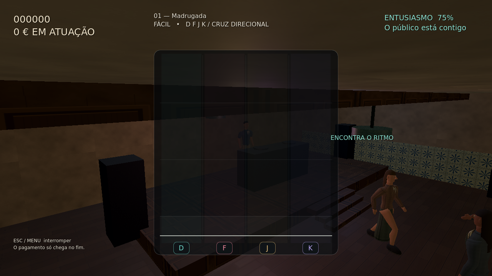
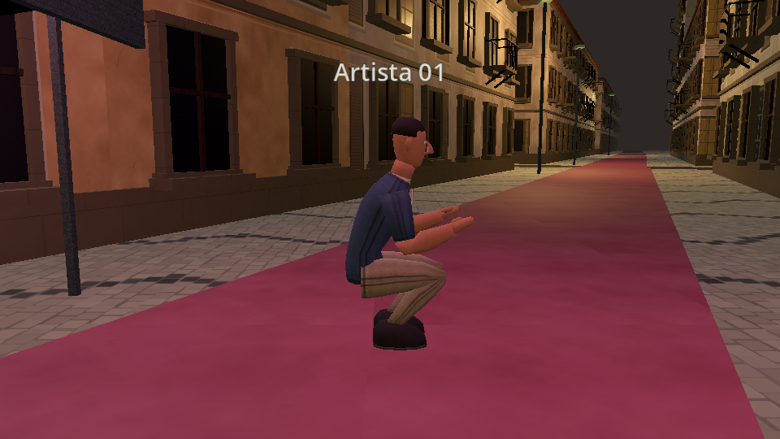
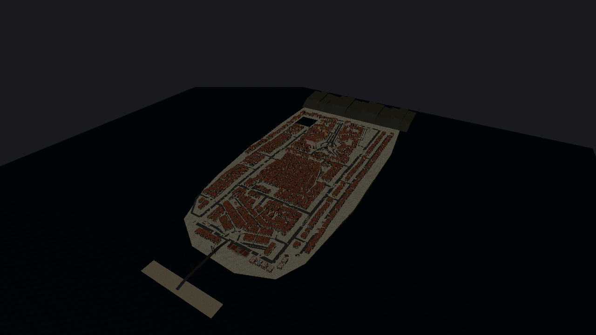

# Revisão de Lisboa — 22 de outubro de 2026

Esta revisão altera o mundo jogável e os controlos no projeto existente. O ponto de partida já é o telhado de um prédio visitável do Saldanha; não é necessário usar a câmara do editor para chegar à cidade nova.

## Mapa e lugares

A península tem **771 500 m²**, com os três bairros ligados por terreno e ruas contínuas, margem do rio, cais e Ponte 25 de Abril estilizada. São **598 contornos OSM preservados e 290 edifícios próprios**, distribuídos por **191 setores de construções**. As 29 ruas próprias completam as ruas dos mapas enviados e oferecem percursos alternativos.

O Saldanha mantém avenida, rotunda e monumento. O Bairro Alto tem um patamar mais elevado, ruas estreitas e ligações por desníveis. A Pink Street conserva a rua rosa e recebe o conjunto de bares e a discoteca. A costa, o relevo e as distâncias entre bairros são uma composição original compacta; não reproduzem a geografia real de Lisboa à escala 1:1.

Os **18 estabelecimentos** têm portas e interiores físicos: restaurantes portugueses, francês e italiano, kebabs, conveniências, fado, bares e discoteca. Há mesas, balcões, esplanadas, toldos, letreiros e varandas apoiadas. Três prédios permitem subir por escadas de madeira através de três pisos até ao terraço. Estes locais têm configurações próprias; as lojas ainda não oferecem um sistema completo de compras ou uma missão exclusiva por estabelecimento.

## Movimento, veículos e atuação

| Problema observado | Alteração entregue |
| --- | --- |
| Pés orientados para trás em relação ao rosto | Orientação dos pés e resolução das articulações corrigidas nas animações; os vinte GLB foram exportados novamente. |
| Agachar deslocava o esqueleto para trás | A bacia desce, joelhos e tornozelos articulam-se e a cápsula baixa com a personagem. A câmara acompanha a mudança suavemente. |
| Degraus baixos obrigavam a saltar | O controlador verifica espaço livre e sobe degraus baixos, sem permitir atravessar paredes altas. |
| Cadência sem relação suficiente com a deslocação | A animação acompanha a velocidade real, preservando a fase da passada nas transições. |
| Veículos presos em pequenos ressaltos | Contactos com o terreno, inclinação e limites de subida ajustados por tipo de veículo. Obstáculos altos continuam a bloquear a passagem. |
| Colisão sem dano visível | Impactos fortes deformam partes da carroçaria e danificam elementos como vidros e luzes. |
| Condução com apoios desajustados | Poses ajustadas ao banco, apoios, guiador e pedais dos veículos próprios. |
| Atuação apenas no Lado B anterior | A mesa de DJ da discoteca da Pink Street abre a escolha de músicas e usa a sua própria câmara e público. |

Há carro, mota, bicicleta e trotinete estacionados perto do prédio inicial. O trânsito usa veículos físicos com condutores, percursos e limitação por proximidade/qualidade. Ainda não é uma simulação completa de circulação com prioridades, semáforos e reações a todos os cruzamentos.

As animações são próprias, geradas por articulações e clips exportados pelo Blender; não são captura de movimento nem animações extraídas de GTA. As correções de orientação e contacto não substituem o acabamento artístico das interações.

No novo clube, os oito clientes mantêm a identidade: deixam a pista, passam pela porta e seguem pelo passeio. Se o público recuperar, regressam a pé; também visitam o balcão durante a atuação. Alterar a audiência não os faz aparecer ou desaparecer na sala. A simulação distante é suspensa fora da área visível, para limitar o custo.

[Ver uma sequência curta de movimento](imagens/revisao-movimento.mp4). O vídeo junta amostras dos clips GLB e posturas para inspecionar articulações; não é uma gravação contínua de deslocação pelos controlos do jogo.

## Apresentação e editor

A imagem usa geometria low-poly texturada, materiais com desgaste, janelas e ferragens próximas, luzes locais e nevoeiro de profundidade. Mipmaps, atlas das personagens, agrupamento de peças, setores, volumes simplificados do horizonte e limites de simulação reduzem trabalho efetivo. O motion blur continua regulável em **Esc → Qualidade**. Gaussian splatting não foi adicionado nesta revisão.

O editor mantém **F10**, palavra-passe local, voo, seleção, eixos, grelha, materiais, luzes, catálogo, missões simples, Desfazer/Refazer e gravação separada em JSON. As edições antigas do Bairro Alto acompanham a nova altura do terreno. O cliente local de IA continua opcional; não inclui um modelo e não foi validado com inferência real nesta máquina.

A vista aérea acima carrega todos os setores e desliga o nevoeiro **apenas para inspecionar a continuidade do mapa**. Não representa as definições normais de jogo, o desempenho do portátil HP ou uma imagem artística final aprovada.

## Como verificar

Descarrega a branch **codex/album-visual-prototipo-02**, extrai o ZIP e importa `project.godot` no Godot Compatibility. Carrega em **F5**, escolhe um artista e desce as escadas do prédio inicial. **Esc → Mapa** mostra os bairros; **E** interage com os veículos e com a mesa do DJ. O [README](../README.md) tem os passos completos para Windows.

Os testes físicos percorrem entradas, escadas, ligações e controlos reais; as capturas são da aplicação nativa. [Validação dos mapas e desta revisão](VALIDACAO_MAPAS.md). Os resultados automatizados não substituem a avaliação visual do criador. Windows/Godot 4.7.2, comando físico e 60 FPS nos portáteis indicados continuam por medir localmente.

As músicas incluídas continuam a ser três instrumentais de ensaio. A integração das faixas autorizadas da banda, identidades finais dos músicos, expansão das missões, vocalizações, consumíveis, combate e escalada completos permanecem trabalho seguinte. O código e os recursos atuais funcionam offline e não dependem dos repositórios GTA consultados.
