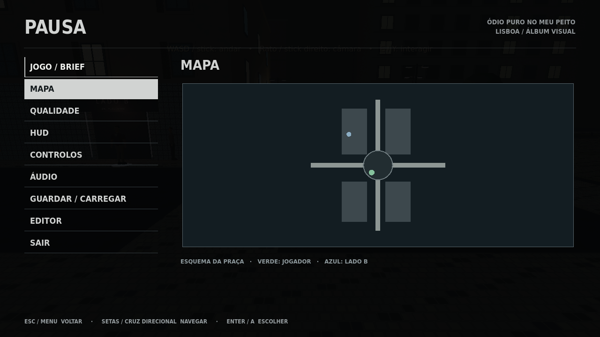
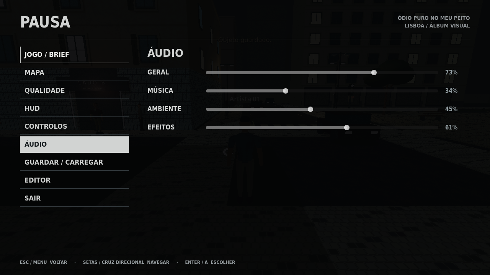
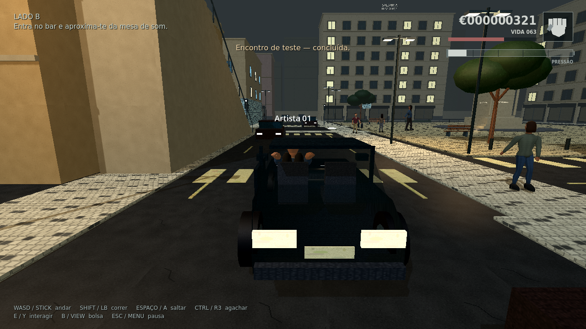
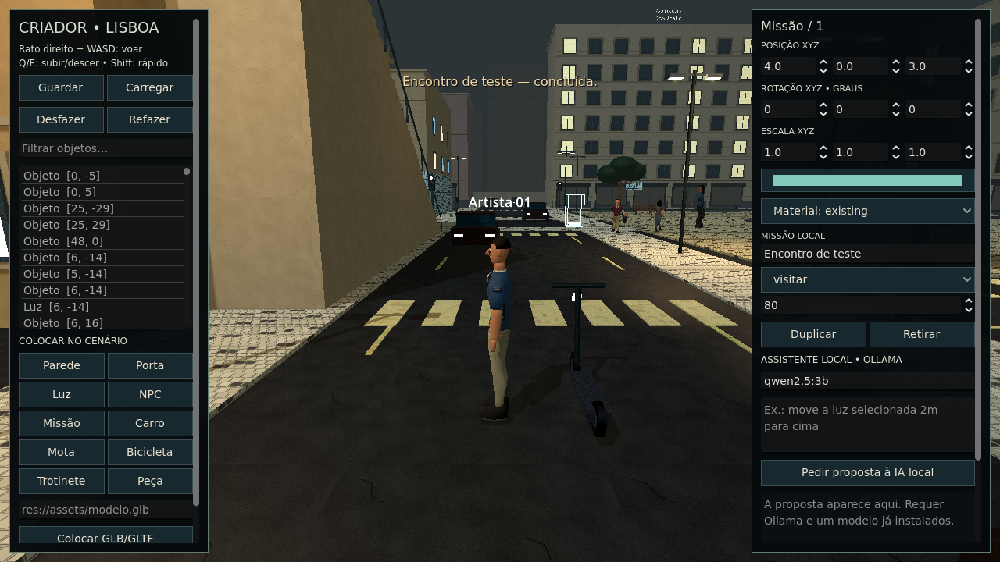

# Validação do protótipo — revisão 2

Executado em **20 de outubro de 2026**, com **Godot 4.6.3 stable**, em Linux na nuvem. A revisão foi verificada por testes de regras, física e integração da cena principal, e por execução com janela nativa. Estes resultados não são medições de desempenho dos portáteis do criador.

**Atualizações posteriores:** [motion blur e editor](VALIDACAO_EDITOR.md) e [integração dos mapas enviados](VALIDACAO_MAPAS.md). As contagens abaixo pertencem à revisão original.

## Testes automatizados

O conjunto de suites de `./tools/run_checks.sh` passou **824 verificações, sem falhas**. A execução completa inicial passou 820; as suites alteradas na revisão final foram repetidas e acrescentaram quatro verificações. No modo headless, duas leituras de transformações MultiMesh foram omitidas porque o renderer dummy não as disponibiliza; ambas foram verificadas depois com renderização nativa.

| Grupo / ficheiro de teste | Verificações headless | Resultado |
| --- | ---: | --- |
| Ritmo — `rhythm_test.gd` | 166 | Passaram |
| Persistência — `save_test.gd` | 72 | Passaram |
| Vinte personagens GLB — `character_test.gd` | 147 | Passaram |
| Jogador e câmara — `player_test.gd` | 19 | Passaram |
| Percurso físico — `world_test.gd` | 20 | Passaram |
| NPCs e população — `npc_test.gd` | 33 | Passaram |
| Circulação no clube — `club_test.gd` | 48 | Passaram |
| Socos e polícia — `wanted_test.gd` | 42 | Passaram |
| Veículos — `vehicle_test.gd` | 69 | Passaram |
| Menu e HUD — `menu_test.gd` | 47 | Passaram |
| Editor — `editor_test.gd` | 50 | Passaram; 2 verificadas na execução nativa |
| Fluxo musical — `music_flow_test.gd` | 24 | Passaram |
| Cena principal — `integration_test.gd` | 25 | Passaram |
| Funcionalidades integradas — `features_test.gd` | 62 | Passaram |

As verificações abrangem:

- **Personagens e movimento:** carregamento dos vinte GLB, dez homens e dez mulheres, materiais texturados, pesos e ossos reais, clips de animação, articulação dos braços durante a marcha e pernas durante a pedalada. A física testa andar, saltar, agachar sob obstáculos, queda fatal, reaparecimento e recentramento da câmara. A qualidade artística e a naturalidade final exigem avaliação humana.
- **Cidade e NPCs:** percurso físico entre telhado, escadas, rua, porta e palco; perceção com campo de visão e paredes; desvio, encontrões, recuperação e cinco perfis de personalidade. A população distante suspende física e colisões. No clube, os mesmos oito corpos caminham pela porta real, esperam se estiver fechada e regressam quando o público recupera; não desaparecem quando a pontuação baixa.
- **Combate e polícia:** direção e alcance dos socos, impedimento de golpes através de paredes, intervalos de dano, testemunhas, pressão policial gradual e redução fora de vista. Os testes distinguem um encontrão de um ataque e verificam a proteção durante a atuação e nos menus.
- **Veículos:** entrada, condução e saída de carro, mota, bicicleta e trotinete; saída bloqueada por obstáculos; queda de bicicleta em impacto frontal forte. A integração utiliza o protagonista real e conserva a sua identidade, malha com skin e rig, com poses próprias e pedalada articulada.
- **Menu, HUD e gravação:** navegação e confirmação de saída, remapeamento sem apagar os eixos do comando, qualidade, população, legendas, brilho e quatro canais de áudio. O salvamento manual repõe dinheiro, vida e posição. O HUD apresenta dinheiro com nove algarismos e pressão policial contínua.
- **Editor:** câmara de voo, transformação de objetos e das suas colisões, edição individual de instâncias, luzes, materiais, catálogo, missões, desfazer/refazer e persistência com recuperação por backup. A missão criada no editor é acionada por interação na cena principal e paga uma única vez.
- **Áudio e ritmo:** reprodução e fim reais de faixa, pré-escuta, relógio musical à distância, transições, acertos/falhas, recuperação do público e pagamento único. As faixas usadas são sintetizadas para teste.

O editor foi testado com propostas estruturadas de exemplo: pré-visualização, rejeição integral de alterações inválidas, aplicar/cancelar e desfazer. **Não foi executado nem validado um modelo de IA real nesta máquina.** A ligação a Ollama está implementada, mas requer serviço e modelo instalados no computador do criador.

## Execução nativa e imagens

A execução com janela usou **OpenGL Compatibility**, num ecrã virtual Xvfb, com **Mesa 25.0.7 / llvmpipe**, um renderer por software. As quatro suites abaixo foram repetidas com renderer real; as contagens incluem verificações de imagem ou de renderização adicionais e não devem ser somadas às anteriores como testes independentes.

| Suite nativa | Verificações | Resultado |
| --- | ---: | --- |
| Menu e HUD | 51 | Passaram |
| Editor | 52 | Passaram, incluindo as 2 omitidas em headless |
| Integração | 29 | Passaram |
| Funcionalidades integradas | 66 | Passaram |

As capturas seguintes são da aplicação nativa em execução, a 1280 × 720. Foram inspecionadas visualmente. A praça, os veículos e as personagens continuam estudos provisórios; as capturas não demonstram que a estética final foi aprovada pelo criador.

## Limites e verificações locais pendentes

- O projeto foi aberto e executado em Linux com Godot 4.6.3. A versão 4.7.2 indicada pelo criador, Windows 10 e uma exportação executável Windows ainda precisam de validação local.
- Não foram medidos FPS no HP EliteBook 745 G2 nem no ASUS Ryzen 7 5700U. Os limites de população, visibilidade, luzes e nevoeiro precisam de afinação nesses computadores; não há garantia de 60 FPS.
- Foram injetados eventos de teclado e comando nos testes. Não foi ligado um comando físico nesta máquina.
- O comportamento de áudio foi testado, mas a mistura e a reatividade dos néons precisam de audição e afinação com as faixas da banda. As músicas e o ambiente presentes são provisórios.
- A IA não inclui pesos de modelos. A avaliação de respostas, velocidade e memória de um modelo local continua pendente; o editor não foi validado como programador autónomo capaz de alterar toda a lógica do jogo.
- Existem quatro veículos conduzíveis, socos e polícia, mas continuam sistemas iniciais. Não constituem uma cidade completa, todos os interiores ou todas as missões do GDD.

O progresso, o salvamento manual, as edições do mundo e as preferências usam ficheiros locais separados em `user://`. A execução dos testes usa diretórios temporários isolados, sem depender dos dados guardados pelo jogador.

Para repetir as verificações em Linux: `./tools/run_checks.sh`. Para testar também o renderer, executar as suites `editor_test.gd`, `menu_test.gd`, `integration_test.gd` e `features_test.gd` sem `--headless`, com Xvfb e diretórios XDG temporários isolados. Os registos desta sessão ficaram em `/tmp/album-v2-all-checks.log` (execução completa), `/tmp/album-v2-final-headless.log` (suites finais alteradas) e `/tmp/album-v2-final-native.log` (repetição com janela). As instruções para abrir e jogar em Windows estão no README.
