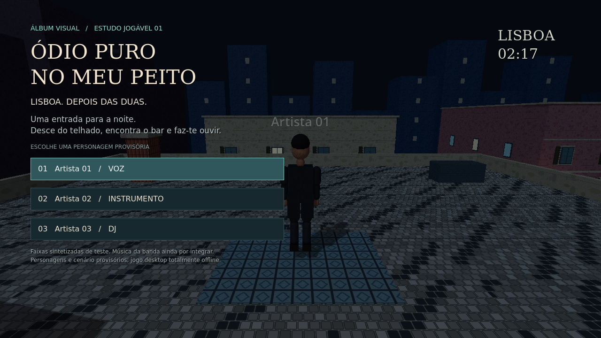
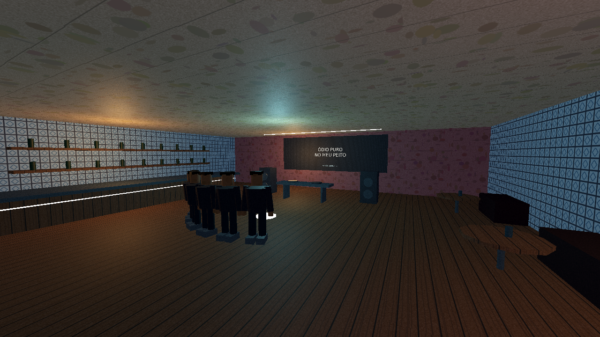

# Validação do primeiro protótipo

Executado em 20 de outubro de 2026 com Godot **4.6.3 stable**, numa máquina Linux na nuvem. Este registo distingue testes de regras, renderização nativa e verificações ainda necessárias no equipamento do criador.

## Verificado

| Grupo | Verificações | Resultado |
| --- | ---: | --- |
| Regras de ritmo | 166 | Passaram |
| Persistência e recuperação de dados | 72 | Passaram |
| Personagem e câmara | 19 | Passaram |
| Percurso físico do quarteirão | 20 | Passaram |
| Reprodução e transições musicais | 24 | Passaram |
| Integração da cena principal | 25 | Passaram |

Os testes incluem acertos e falhas, recuperação do público, valores de pagamento e pagamento único; bolsa de oito espaços, equipamento, perda por morte, JSON inválido e recuperação do backup; movimento, salto, agachamento sob obstáculos, colisões, queda fatal e recentramento; travessia física entre telhado, escadas, rua, porta e palco; pré-escuta, sincronização pelo relógio de áudio e conclusão pelo evento real de fim da faixa.

A cena principal foi também executada com janela nativa em **OpenGL Compatibility**, num ecrã virtual Xvfb, com renderização por software Mesa/llvmpipe. Foram capturadas e inspecionadas imagens do menu, exploração, repertório e atuação. As capturas não são desenhos de uma interface nem uma versão web.

## Limites

- A execução com janela e os testes ocorreram em Linux. O projeto ainda precisa de ser aberto no Godot do ASUS com Windows 10 e de uma exportação Windows validada.
- A compatibilidade e o desempenho no HP EliteBook 745 G2 não foram medidos. Não há garantia de 60 FPS.
- Foram injetados eventos de comando nos testes. Não foi ligado um comando físico nesta máquina.
- Reprodução, posições e eventos reais de áudio foram testados; a mistura final precisa de audição no computador do criador. As músicas são sintetizadas de teste e os mapas de notas são gerados sobre os seus BPM conhecidos.
- O espectro é analisado pelo motor e controla os néons; o resultado final precisa de afinação com as faixas da banda e o equipamento de som do criador.
- Não há modelo de IA, exportação executável, veículos conduzíveis, combate ou cidade completa nesta entrega.

A reprodução distante usa um relógio virtual e a luz é analisada antes da atenuação do volume. O salvamento do jogador usa o diretório local `user://`; ficheiros do mundo editado serão separados quando o editor for implementado.

Para repetir as verificações em Linux: `./tools/run_checks.sh`. As instruções de Windows para jogar estão no README.
