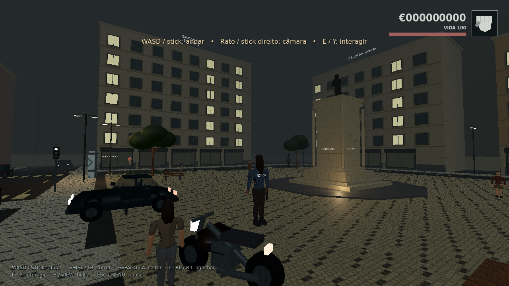
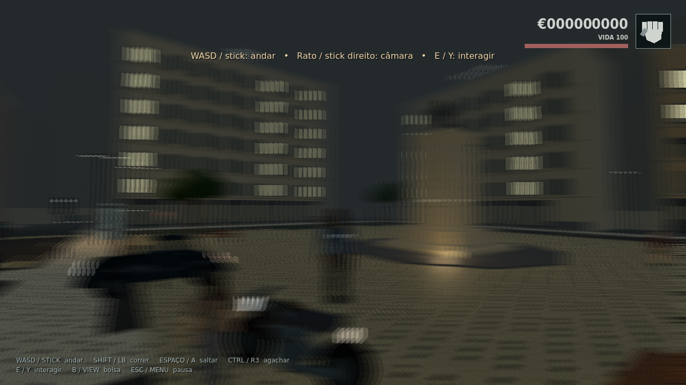
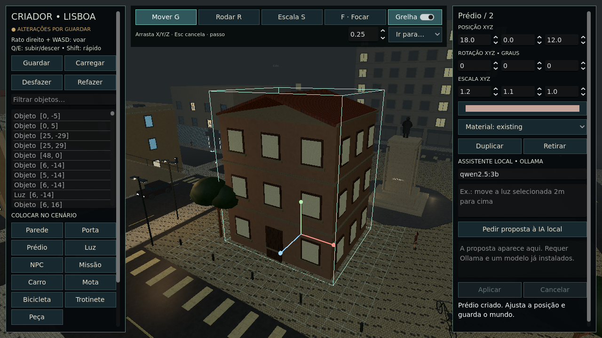

# Validação — motion blur e editor visual

Atualização de **21 de outubro de 2026**, no projeto e branch existentes. O criador autorizou avançar após a auditoria das 19 etapas. Esta entrega desenvolve motion blur e ferramentas do editor enquanto aguarda os mapas locais indicados pelo criador. Esta nota retrata esse checkpoint anterior. Os mapas foram recebidos depois e a integração dos três bairros/ponte está em [VALIDACAO_MAPAS.md](VALIDACAO_MAPAS.md).

## Alterações entregues

- **Motion blur estilizado da câmara**, regulável em Esc → Qualidade. Usa deslocação/rotação da câmara e seis amostras de ecrã quando há movimento; partilha o passe de brilho que já existia, sem capturar a imagem para o CPU ou manter uma textura do fotograma anterior.
- Intensidade inicial 0,35; zero desliga as amostras de blur. Menus, editor e morte desativam o efeito; cortes de câmara, mudanças de projeção e teletransportes não reutilizam movimento antigo. HUD e menus são desenhados depois do efeito.
- **Eixos arrastáveis** para mover/rodar/escalar, incrementos ajustáveis, cancelamento e um único passo de Desfazer por arrasto. Transformações mantêm as colisões associadas.
- **Focar seleção**, vistas rápidas de câmara, luz de inspeção só durante edição, indicador de alterações por guardar e opções de saída com guardar/continuar/voltar sem guardar. Fechar a janela no editor também passa pela proteção das alterações.
- **Prédio-base original**, exterior fechado com texturas PBR, janelas, cornijas e telhado. Os pormenores partilham lotes de desenho por material. Alterar a fachada preserva janelas/telhado; a colisão e a caixa de seleção acompanham o conjunto.

O blur é um efeito de ecrã orientado pelo movimento da câmara. Não reconstrói profundidade nem a velocidade individual de cada NPC/objeto; pode misturar contornos próximos e distantes quando forte. É uma escolha estética ajustável, não uma garantia de melhoria de desempenho.

## Testes executados

Godot **4.6.3**, Linux, renderer **Compatibility**. O conjunto completo `./tools/run_checks.sh` executou **15 suites, 865 verificações, zero falhas**. O script também rejeita erros de script/recursos emitidos pelo motor, mesmo quando o processo Godot termina com código zero.

As 824 verificações da base continuam presentes. `tests/presentation_test.gd` acrescenta **41 verificações headless** na cena principal real: intensidade/persistência, cortes de câmara, entrada no editor, arrastos e colisões, grelha, rotação/escala, desfazer/refazer, seleção por coordenadas de ecrã, vistas, luz, construção agrupada, materiais, gravação/carregamento e saída protegida.

Duas verificações antigas de transformações MultiMesh continuam explicitamente omitidas em headless e passaram com renderer nativo em `editor_test.gd`: **52 verificações, zero falhas**. As três comparações de imagem do novo efeito exigem renderer nativo e não são apresentadas como testes passados no modo headless.

Na execução com janela, Xvfb e Mesa/llvmpipe por software, `presentation_test.gd -- --screenshots` passou **45 verificações, zero falhas**: as 41 verificações funcionais, três comparações de imagem e gravação da captura do editor. A verificação da cena principal em `features_test.gd` também passou **66 verificações nativas**, incluindo as capturas. Estas reexecuções não são somadas ao total headless como testes independentes.

### Comparação real da imagem

Com a cena e câmara de teste controladas, a rotação produziu cerca de **515 mil píxeis alterados** entre blur desligado e intensidade máxima. Os píxeis opacos do dinheiro/ícone do HUD permaneceram iguais. Ao parar a câmara, a comparação com a imagem sem blur encontrou **zero píxeis acima da tolerância de 0,016 por canal RGB**. Não foram aceites alterações permanentes de cor para simular o efeito.

## Limites e trabalho pendente

- Os mapas indicados na pasta Windows `Maps` não foram anexados nem disponibilizados ao ambiente. Ainda não foram recortados ou importados; a colocação definitiva da Ponte 25 de Abril junto ao Tejo depende da sua inspeção. [Instruções de entrega](ENTREGAR_MAPAS.md).
- Gaussian splatting continua admitido para planos/fundos específicos. Não foi integrado um renderer ou recurso de splats, nem se mediu uma vantagem para este cenário.
- Não houve medição no ASUS ou HP, execução Windows/Godot 4.7.2, comando físico ou exportação Windows nesta atualização. O renderer por software da nuvem não prova 60 FPS no HP.
- A ligação Ollama e as propostas estruturadas do editor são preservadas, mas continua sem modelo instalado ou inferência real validada nesta máquina.
- O prédio-base é uma ferramenta para prototipar exteriores; não cria automaticamente interiores, modelos finais, ruas, trânsito ou missões narrativas completas.

Registos desta sessão: `/tmp/album-v3-final-all.log`, `/tmp/album-editor-clean-native.log`, `/tmp/album-native-editor.log` e `/tmp/album-native-features.log`. As capturas incluídas foram obtidas na aplicação, não geradas como ilustrações.
