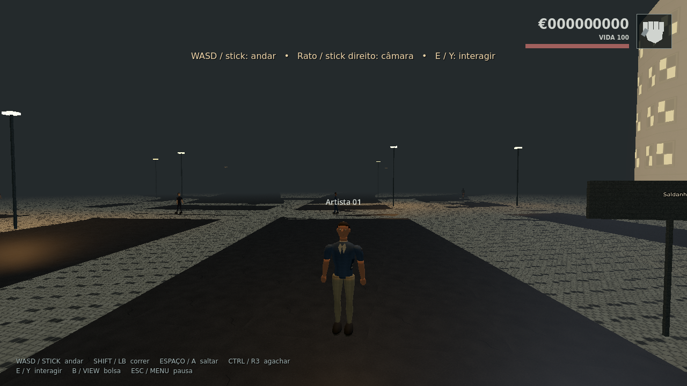
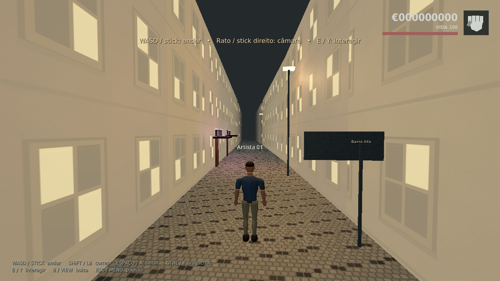
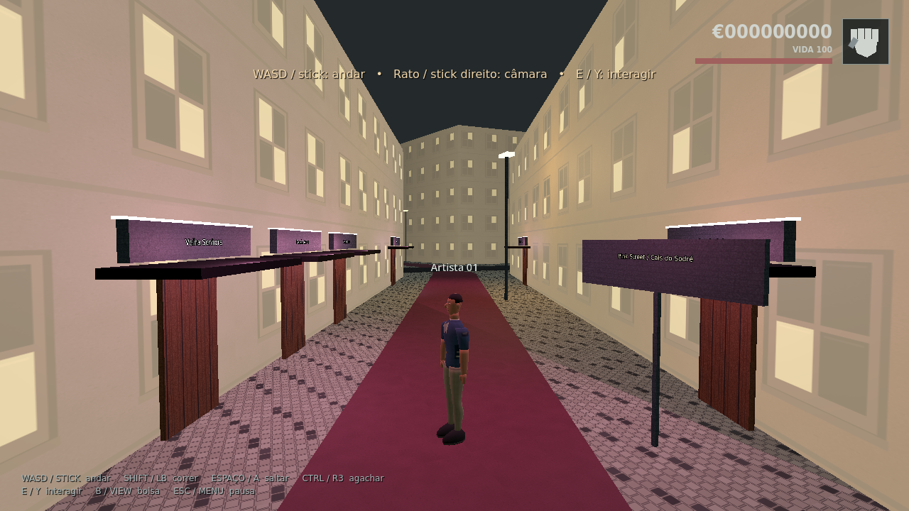
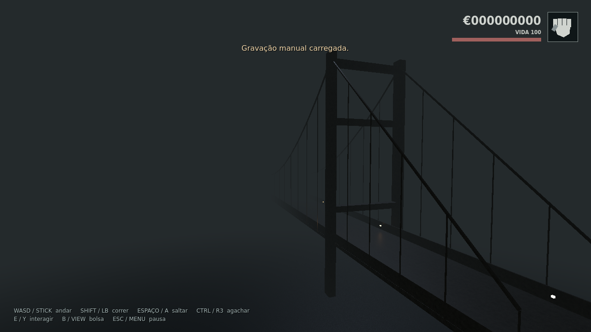
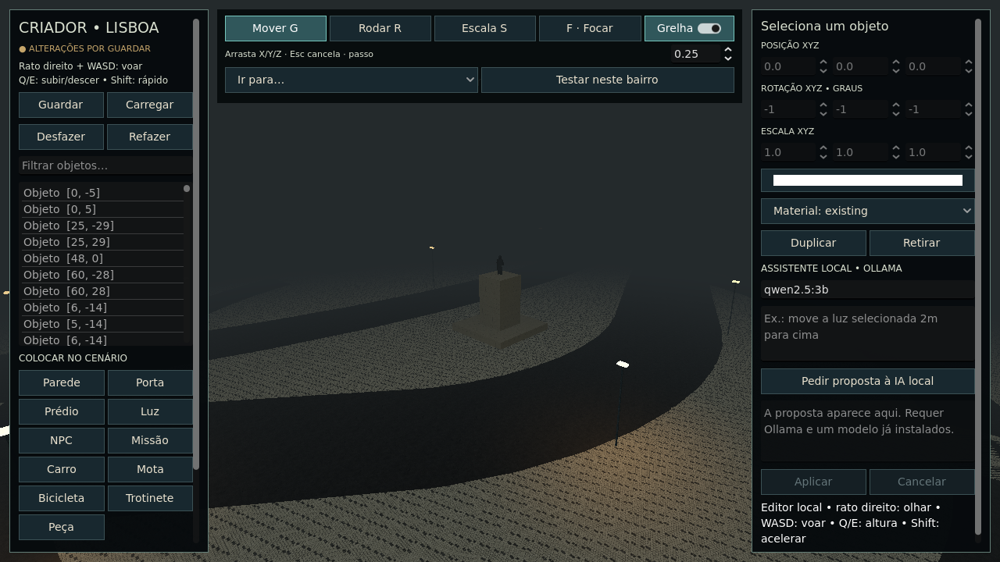
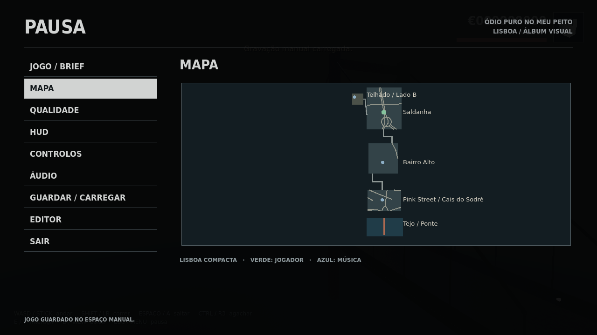

# Validação — mapas enviados pelo criador

Atualização de **21 de outubro de 2026**, no projeto e branch existentes. Integra os dois OSM extraídos de `Maps.rar`, com recortes do Saldanha, Bairro Alto e Pink Street. Mantém os originais, o percurso inicial, Lado B, missão, ritmo, gravações e editor. [Âmbito, uso e limitações](ENTREGAR_MAPAS.md).

## Dados e geometria

- Quatro testes Python passaram: integridade SHA-256/tamanho dos originais; três recortes/ruas/rotas; geometria fechada e recortada; metadados/licença. A verificação percorre os 598 contornos, confirma que a área triangulada de cada cobertura coincide com a área exterior menos os pátios e rejeita IDs repetidos ou pontos fora dos recortes.
- A regeneração com Python/Shapely foi repetida: os SHA-256 dos **91 JSON** foram idênticos. Não há pedidos de rede no importador nem dependência de Python/Shapely para jogar.
- As construções usam alturas/pisos OSM quando presentes; **463 contornos têm altura inferida**. Terreno plano, fachadas próprias repetidas e letreiros de estabelecimentos aproximados são provisórios. O arquivo não contém interiores, texturas ou relevo.
- A base OSM original/derivada conserva atribuição e ODbL 1.0. Atribuição também visível no menu Jogo/Brief. Os letreiros transportam nomes e posições; contactos dos pontos OSM não são propagados para os dados de execução.

## Jogo e persistência

`./tools/run_checks.sh` passou **942 verificações GDScript em 16 suites**, além dos quatro testes Python. Inclui as 865 verificações existentes e **77 novas verificações de mapas**:

- Manifesto com três zonas e 90 setores; chão real por baixo das três ruas de referência e coberturas com colisão pelo lado superior.
- Construções próximas carregadas e distantes removidas; sem exigir carregar os 90 setores simultaneamente. O chão simples permanece residente.
- IDs estáveis de prédios, letreiros e candeeiros. Editar/guardar, sair da zona, carregar o ficheiro com o setor ausente e regressar conserva a transformação e colisões. Desfazer também funciona quando o alvo está descarregado. Um prédio movido para outra região carrega perto da nova posição.
- População com identidades persistentes e catálogo de vinte aparências reutilizado nas quatro regiões. O orçamento é global; física, colisões e animações dos habitantes distantes ficam suspensas.
- Guardar/Carregar manual nas coordenadas novas, com dinheiro/progresso; rejeição de coordenadas inválidas e lacunas fora das áreas jogáveis.
- Três emissores de faixas instrumentais de teste, volume progressivo e relógio virtual; o DJ e a música do Lado B mantêm a sua suite anterior de integração.
- Botão do editor **Testar neste bairro**, incluindo proteção das edições por guardar, colocação num ponto seguro e atualização do ponto de reaparecimento.
- Travessia física, por cápsula, das três ligações, respetivas curvas/fronteiras e duas rampas/tabuleiro da ponte.
- **Carro real do jogo** conduzido por comandos simulados: subida da primeira rampa, travessia do tabuleiro e descida para o cais oposto. O teste identificou um ressalto que bloqueava o carro com a rampa em caixa; foi substituída por uma superfície contínua, alinhada com o tabuleiro.

Continuam duas omissões do renderer dummy em `editor_test.gd` e as comparações de imagem do blur em `presentation_test.gd`; não são contadas como passadas em headless. Foram verificadas com janela nativa abaixo.

## Renderização nativa

Godot **4.6.3**, Compatibility, 1280 × 720, Xvfb/Mesa llvmpipe em Linux. Nenhuma medição de desempenho dos portáteis do criador.

| Suite com janela | Verificações | Resultado |
| --- | ---: | --- |
| Editor | 52 | Passaram; inclui as duas leituras MultiMesh omitidas em headless |
| Apresentação / motion blur | 45 | Passaram; HUD preservado e diferença de 0 píxeis com câmara parada |
| Mapas, `--screenshots --captures-only` | 49 | Passaram; inclui seis capturas |

A variante nativa de mapas repete integração/edições/gravação/áudio e captura as cenas. Omite os percursos físicos longos de cápsula/carro, já executados em headless; não somar estas contagens como testes independentes. As capturas foram inspecionadas e mostram o estado provisório, sem afirmar aprovação artística final.

## Limites

A construção de setores é síncrona, limitada a dois por atualização, e ainda pode causar pausas em hardware lento. Há geometria real a descarregar, mas não há níveis completos de detalhe de malha, trânsito nas ruas novas, reconstrução de relevo nem interiores novos de bares. Os quatro veículos atuais continuam provisórios; o teste da ponte não valida todos os casos de condução da cidade. O nevoeiro esconde distância; não reduz sozinho o custo das construções próximas.

Windows/Godot 4.7.2 e o objetivo de 720p/60 FPS no HP A8 PRO-7150B continuam por testar no equipamento real. IA local requer Ollama/modelo e não foi executada nesta máquina. Os ficheiros da banda continuam em falta; as faixas incluídas são instrumentais sintetizadas.

Registos da sessão: `/tmp/album-maps-validated.log`, `/tmp/album-maps-release-native.log`, `/tmp/album-maps-final-native-editor.log`, `/tmp/album-maps-final-native-presentation.log`, `/tmp/album-maps-deterministic-check.log`. Os testes usam dados temporários separados dos saves do jogador.
